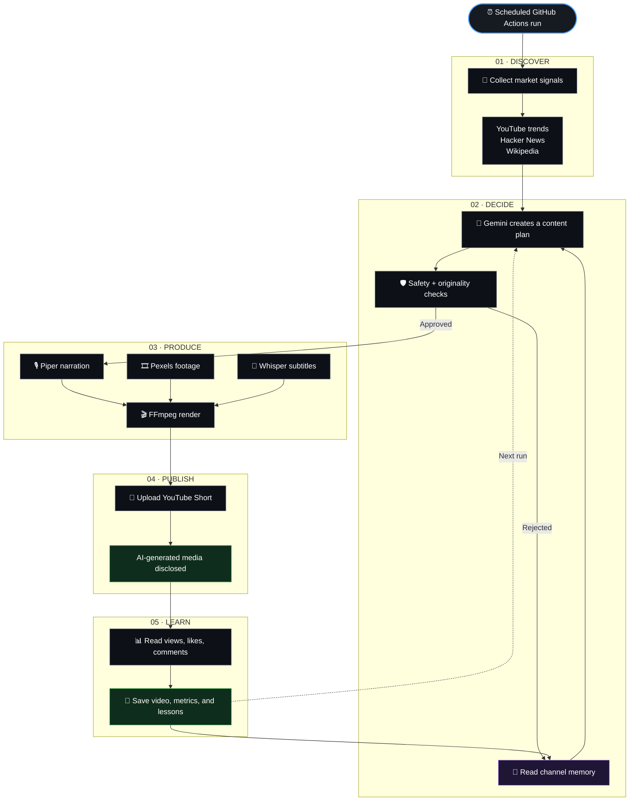

<div align="center">

# 🤖 AI Influencer

### An autonomous content engine for YouTube Shorts

**Discover → Decide → Produce → Publish → Learn**

AI Influencer turns market signals into short-form videos with Gemini, Piper, Pexels, Whisper, FFmpeg, YouTube, and GitHub Actions.

<br />

[](https://github.com/AdamexTy/ai-influencer/actions/workflows/daily.yml)
[](https://www.python.org/)
[](https://www.youtube.com/)
[](LICENSE)

<br />

[**▶ Watch the channel and follow the project's progress on YouTube**](https://www.youtube.com/@P1xelParadox)

</div>

---

## 📺 Follow the live experiment

This repository powers the **P1xelParadox** YouTube channel. Watch the videos generated by the system, follow the channel's growth, and see how the project evolves over time.

[](https://www.youtube.com/@P1xelParadox)

> The channel is the public output of this project. The repository contains the automation, while YouTube shows the real-world results: published Shorts, experiments, performance, and progress.

---

## Why this project exists

Most content automation scripts stop after generating text. **AI Influencer is an end-to-end experiment in autonomous media:** it researches what is interesting, chooses what to make, creates the video, publishes it, reads the results, and uses that history on the next run.

It is built for creators, developers, and curious builders who want to explore what a small, low-cost content system can do without a permanent server.

> **Current status:** Alpha / experimental. The pipeline is functional, but autonomous publishing should still be monitored by a human.

---

## 🔁 The autonomous content loop

The system is a continuous feedback loop. Every published Short becomes data that helps the next planning decision.



### What happens at each stage

| Stage | What the agent does | Output |
|---|---|---|
| **Discover** | Collects current signals from YouTube, Hacker News, and Wikipedia | Market context |
| **Decide** | Uses Gemini, channel memory, and past performance to choose an idea | Topic, title, script, keywords, metadata |
| **Filter** | Checks safety, quality, and exact or near-duplicate content | Approved plan or lesson |
| **Produce** | Creates narration, sources footage, generates subtitles, and renders the video | `work/final.mp4` |
| **Publish** | Uploads the Short and declares synthetic media | Public YouTube video |
| **Learn** | Reads performance metrics and stores the result | Updated `memory/memory.json` |

> **The important part:** the loop does not end when the video is uploaded. The result is written back into memory and influences the next idea.

---

## Highlights

### 🧠 Strategy, not just generation

The planner receives recent channel performance, market signals, channel identity, lessons, and a history of published topics. It is instructed to balance proven formats with controlled experimentation.

### 🛡️ Duplicate-aware memory

The system does not depend on the model remembering everything. It checks normalized titles, topics, scripts, content hashes, and pending plans before expensive video production begins.

That helps prevent the classic failure mode of publishing the same story three times with slightly different wording.

### ⚙️ Serverless automation

There is no always-on backend. GitHub Actions schedules the runs, performs the work on a hosted runner, and commits updated memory back to the repository.

### 💸 Built around free and open tools

The default pipeline uses free-tier APIs and open-source software wherever practical. Costs and quotas still depend on the providers and your account.

---

## Architecture

| Layer | Responsibility | Implementation |
|---|---|---|
| Scheduler | Start unattended runs | GitHub Actions |
| Research | Find current signals | YouTube, Hacker News, Wikipedia |
| Planner | Choose and package an idea | Gemini API |
| Guardrails | Validate safety and originality | Python |
| Memory | Persist history and lessons | `memory/memory.json` |
| Voice | Generate narration | Piper TTS |
| Visuals | Find stock clips | Pexels API |
| Captions | Transcribe narration | faster-whisper |
| Rendering | Compose the final video | FFmpeg |
| Publishing | Upload and disclose AI media | YouTube Data API v3 |
| Feedback | Store performance metrics | YouTube API |

---

## Repository layout

```text
ai-influencer/
├── .github/workflows/daily.yml  # Schedule, permissions, caching, memory commit
├── memory/memory.json            # Channel identity, videos, metrics, lessons
├── src/
│   ├── agent.py                  # Gemini models, prompts, planning
│   ├── feedback.py               # YouTube metrics collection
│   ├── get_token.py              # One-time OAuth helper
│   ├── guardrails.py             # Safety and content validation
│   ├── identity.py               # Optional channel identity generator
│   ├── main.py                   # Pipeline orchestration
│   ├── market.py                 # Trend and market signal collection
│   ├── memory_store.py           # Atomic persistence and similarity checks
│   ├── produce.py                # TTS, clips, subtitles, FFmpeg
│   └── upload.py                 # YouTube upload and metadata
├── requirements.txt
├── CHANGELOG.md
├── LICENSE
└── README.md
```

---

## Quick start

### Requirements

- Python **3.11+**
- FFmpeg
- A Google Cloud project with YouTube Data API v3 enabled
- Gemini API key
- Pexels API key
- YouTube OAuth credentials
- A GitHub repository with Actions enabled

### Install locally

```bash
git clone https://github.com/AdamexTy/ai-influencer.git
cd ai-influencer

python -m venv .venv

# macOS / Linux
source .venv/bin/activate

# Windows PowerShell
.venv\Scripts\Activate.ps1

pip install -r requirements.txt
```

### Configure YouTube OAuth

Create a Desktop OAuth client in Google Cloud and place the downloaded client file at the repository root as `client_secret.json`.

Then generate a refresh token:

```bash
cd src
python get_token.py
```

Keep `client_secret.json` and all token values private. Never commit them.

### Configure GitHub Actions secrets

Add these under **Settings → Secrets and variables → Actions**:

| Secret | Purpose |
|---|---|
| `GEMINI_API_KEY` | Idea generation and scripts |
| `PEXELS_API_KEY` | Stock footage |
| `YOUTUBE_API_KEY` | Market research |
| `YT_CLIENT_ID` | YouTube OAuth |
| `YT_CLIENT_SECRET` | YouTube OAuth |
| `YT_REFRESH_TOKEN` | Uploads and analytics |

Optional monitoring:

| Secret | Purpose |
|---|---|
| `HEALTHCHECK_URL` | Success/failure heartbeat |
| `NTFY_URL` | Failure notifications |

### Allow memory commits

The workflow updates `memory/memory.json` after each run. Enable:

```text
Settings → Actions → General → Workflow permissions → Read and write permissions
```

### Launch a run

- Automatic: wait for the configured schedule.
- Manual: **Actions → ai-influencer → Run workflow**.

---

## Schedule

The default workflow requests three runs per day in UTC:

```text
13:00 UTC
16:30 UTC
19:00 UTC
```

GitHub schedules are best-effort. The workflow uses concurrency protection so runs do not intentionally overlap while editing memory.

Change the schedule in [`.github/workflows/daily.yml`](.github/workflows/daily.yml).

---

## Memory and duplicate prevention

The persistent state lives in [`memory/memory.json`](memory/memory.json). It contains:

- Channel identity and niche.
- Published YouTube video IDs.
- Topics, titles, scripts, and content hashes.
- Views, likes, comments, and subscriber totals.
- Rejected plans and technical lessons.
- A temporary pending plan during production.

The duplicate pipeline detects:

- Exact title matches.
- Exact topic matches.
- Normalized title variations.
- Semantically similar topics.
- Similar scripts.
- Matching content hashes.
- A plan already reserved by another in-progress run.

Publication state is deliberately handled in two phases:

```text
plan accepted → pending reservation → video uploaded → published memory record
                                      └─ failure → reservation removed, retry remains possible
```

Memory writes are atomic, which reduces the chance of leaving behind a half-written JSON file after a runner interruption.

---

## Safety and operational guardrails

The local validation layer checks for:

- Restricted or unsafe topics.
- Missing topics, scripts, or keywords.
- Invalid script lengths.
- Duplicate and near-duplicate content.
- Failed production and upload paths.
- Retry-safe publication behavior.

Uploads also declare synthetic media through YouTube metadata.

**Important:** automated checks are not a substitute for editorial judgment. Review the channel regularly, especially when changing prompts, models, or publishing frequency.

---

## Validation

The repository currently has lightweight validation rather than a large test suite. Run:

```bash
python -m compileall src
python -m json.tool memory/memory.json > /dev/null
```

If tests are present in your checkout, run:

```bash
python -m unittest discover -s tests -v
```

---

## Free-tier notes

| Service | Role | Consideration |
|---|---|---|
| GitHub Actions | Scheduling and execution | Runner time and scheduling are limited by account policy |
| Gemini | Planning and scripts | Model availability and daily quota can change |
| Pexels | Stock video | API key and rate limits apply |
| YouTube Data API | Uploads and metrics | Uploads consume quota |
| Piper | Narration | Local, free, CPU-based |
| faster-whisper | Subtitles | CPU rendering can be slow on shared runners |
| FFmpeg | Video composition | Open source |

Provider quotas and policies change. Treat the values above as operational guidance, not guarantees.

---

## Roadmap

- [x] Scheduled autonomous runs
- [x] Market signal collection
- [x] Gemini content planning
- [x] Voice-over, footage, subtitles, and rendering
- [x] YouTube Shorts publishing
- [x] Metrics feedback loop
- [x] Persistent memory
- [x] Duplicate and near-duplicate detection
- [ ] Automated thumbnail experiments
- [ ] Hook and title A/B testing
- [ ] Scene-by-scene visual planning
- [ ] Analytics dashboard
- [ ] Multi-platform publishing

---

## Troubleshooting

### The workflow cannot commit memory

Check that workflow permissions are set to **Read and write permissions** and that the repository is not blocking workflow-created pushes.

### The same idea appears again

Inspect `memory/memory.json` and confirm that the previous upload has a topic, title, script, and content hash. Check the workflow logs for duplicate-rejection messages.

### YouTube authentication fails

Refresh-token problems are commonly caused by OAuth test mode or expired credentials. Re-run `src/get_token.py` and update the repository secrets.

### Video production is slow

The first run may download Piper and Whisper assets. Shared GitHub runners can also vary in CPU and network speed.

---

## Security checklist

- Never commit API keys or refresh tokens.
- Never commit `client_secret.json`.
- Use repository secrets for all credentials.
- Review generated content before enabling frequent publishing.
- Rotate credentials immediately if they are exposed.
- Keep the repository's Actions permissions as narrow as practical.

---

## Contributing

Pull requests and ideas are welcome.

Before opening a pull request:

1. Keep credentials and generated secrets out of commits.
2. Update documentation when behavior changes.
3. Run the validation commands.
4. Explain how the change affects autonomous publishing.
5. Prefer small, reviewable changes.

If you fork this project, use your own channel identity, OAuth client, API keys, and refresh token.

---

## License

MIT — see [`LICENSE`](LICENSE).

<div align="center">

**Built as an experiment in autonomous media systems.**

</div>
